 

 

## 🧭 About Me

I design and ship web products from idea to deployment. I built **ChatCore**, a production AI chat widget SaaS, and I co-founded **CelVoxe**, a web development agency. I am a Software Engineering student, and right now I am strengthening my backend skills while working with AI APIs.

- 💼 **Role:** Frontend Developer · Full-Stack Engineer (MERN, growing)
- 🏢 **Co-Founder:** [CelVoxe](https://celvoxe.com) — web development & digital services
- 🚀 **Building:** [ChatCore](https://github.com/shahzaib-codes776/Chatcore) — AI chat widget for businesses
- 🌱 **Learning:** Node.js, Express, MongoDB, AI integration
- 💬 **Open to:** Freelance work and collaboration

## ⚙️ Tech Stack

**Frontend** 

**Backend** 

**Database** 

**Languages** 

**Tools & Deployment** 

**AI** 

## 📌 Featured Work

### 💬 [ChatCore](https://github.com/shahzaib-codes776/Chatcore) — AI chat widget for businesses

Businesses add one script to their website. Visitors get instant answers based on the business's own data, every conversation is saved as a lead, and owners manage everything from a dashboard.

🔗 **[Live Demo](https://chatcore-app-shahzaib.netlify.app/)** &nbsp;·&nbsp; 📂 **[Source Code](https://github.com/shahzaib-codes776/Chatcore)**

### 🌐 [CelVoxe](https://celvoxe.com) — Agency website (formerly DelVoxe)

Official website of CelVoxe, a software house offering web development and digital services. Built end to end with service pages, portfolio case studies, and contact and quote pages.

🔗 **[Visit Site](https://celvoxe.com)** &nbsp;·&nbsp; 📂 **[Source Code](https://github.com/shahzaib-codes776/delvoxe)**

## 🧩 More Projects

- 🎵 **[Audio Visualizer Player](https://github.com/shahzaib-codes776/InternGrow_AudioVisualizerPlayer)** — responsive web audio player with a real-time frequency spectrum on HTML5 Canvas. `JavaScript` `Web Audio API`
- 🧮 **[Programmer Calculator](https://github.com/shahzaib-codes776/InternGrow_ProgrammerCalculator)** — a calculator built for programmers. `HTML` `CSS` `JavaScript`
- 🦖 **T-Rex Runner Clone** — game clone with real-time animation and object-oriented game logic. `C#` `Windows Forms`
- 🚗 **Campus Ride-Sharing App** — ride-sharing app for campus, built in 6th semester. `C#`
- 🎮 **Tic-Tac-Toe & Rock Paper Scissors** — classic games built to practice logic and UI. `C#`
- 🌐 **[Portfolio Website](https://shahzaibshoukat.tech)** — my personal 5-page portfolio.

## 🎯 What I Can Build For You

- 🖥️ **Modern Websites** — fast, responsive business and agency websites with React and Next.js
- 🤖 **AI Chatbot Integration** — chat widgets that answer customer questions using your own business data
- ⚙️ **Full-Stack Apps** — dashboards, APIs, and databases with Node.js, Express, and PostgreSQL

 

## 📫 Let's Connect

📧 **shahzaibsatti2005@gmail.com** &nbsp;|&nbsp; 🌐 **[shahzaibshoukat.tech](https://shahzaibshoukat.tech)** &nbsp;|&nbsp; 💼 **[LinkedIn](https://www.linkedin.com/in/shahzaib-shoukat-68765439a/)**

